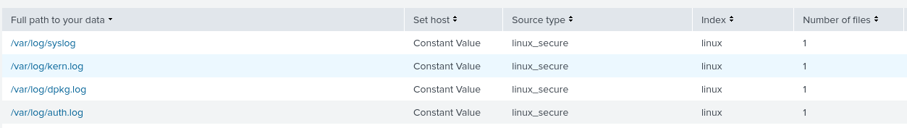
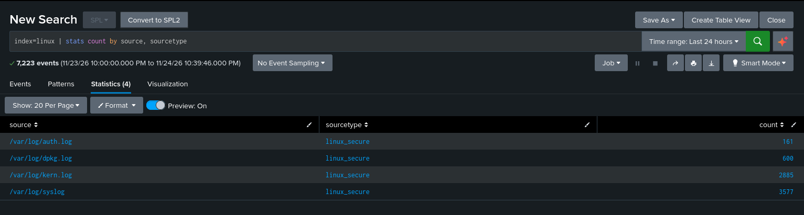

# Splunk Threat Intel Lab

Home lab for practicing SIEM data onboarding, detection engineering, and threat intelligence integration.

## Environment
- Splunk Enterprise 10.6 on Kali Linux (VMware Fusion, 3 vCPU, 7.5 GB RAM)
- Splunk runs as a dedicated service account under systemd (least privilege)

## Data sources
| Index | Source | Sourcetype |
|---|---|---|
| linux | /var/log/auth.log | linux_secure |
| linux | /var/log/syslog, kern.log | syslog |

## Detections
| Detection | MITRE ATT&CK | File |
|---|---|---|
| Linux brute force | T1110 | [linux_bruteforce.md](detections/linux_bruteforce.md) |

## Troubleshooting notes
- Splunk Web timed out at 3.8 GB RAM because the VM was swapping; raised it to 7.5 GB.
- Kali logs to journald by default; installed rsyslog to write auth.log and syslog.
- The splunk user couldn't read the logs; added it to the `adm` group instead of running as root.

## Roadmap
- [x] Linux log onboarding
- [x] First detection (brute force)
- [ ] Three more Linux detections
- [ ] Threat intel feed (abuse.ch) with Python
- [ ] Windows endpoint telemetry (Sysmon)
