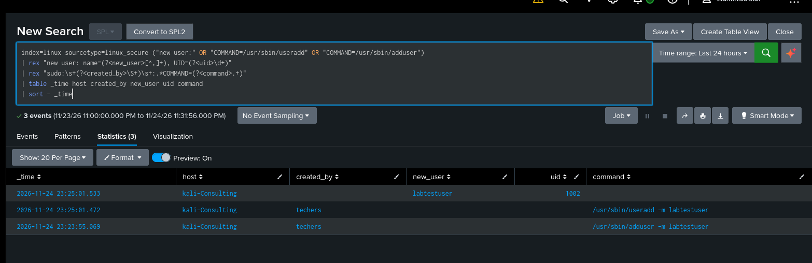
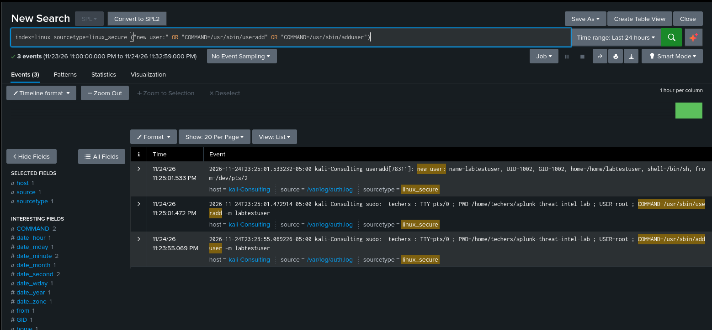

# Linux - New Local User Created

**MITRE ATT&CK:** T1136.001 - Create Account: Local Account
**Data source:** `index=linux sourcetype=linux_secure` (/var/log/auth.log)
**Schedule:** Hourly alert, one alert per new account, severity High

## What it detects
Creation of a local user account with `useradd` or `adduser`, including who ran the command.

## SPL
```
index=linux sourcetype=linux_secure ("new user:" OR "COMMAND=/usr/sbin/useradd" OR "COMMAND=/usr/sbin/adduser")
| rex "new user: name=(?<new_user>[^,]+), UID=(?<uid>\d+)"
| rex "sudo:\s+(?<created_by>\S+)\s+:.*COMMAND=(?<command>.+)"
| table _time host created_by new_user uid command
| sort - _time
```

## How to test
1. `sudo useradd -m labtestuser`
2. Run the search over the last 15 minutes
3. Clean up: `sudo userdel -r labtestuser`

## Why it matters
Attackers create local accounts to keep access to a compromised host (persistence).

## False positives
- Administrators onboarding new users
- Software packages that create service accounts during install

## Evidence


