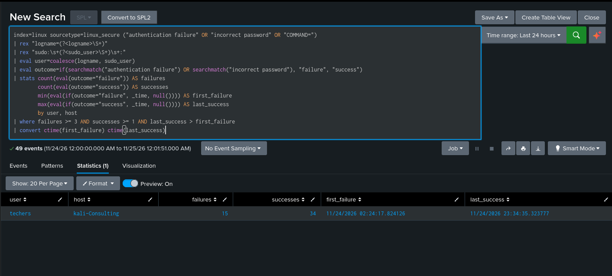
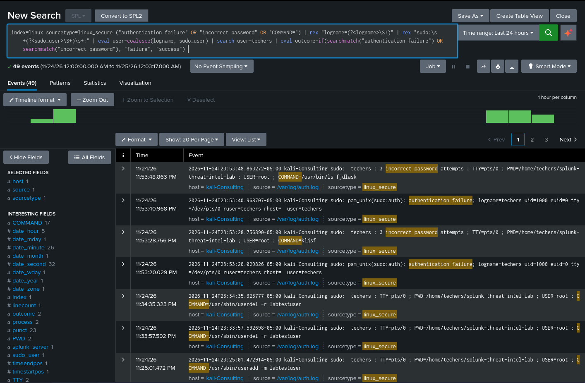

# Linux - Sudo Success After Failures

**MITRE ATT&CK:** T1110 - Brute Force, then T1078 - Valid Accounts
**Data source:** `index=linux sourcetype=linux_secure` (/var/log/auth.log)
**Schedule:** Hourly alert over the last 60 minutes, throttled 60 minutes, severity High

## What it detects
Three or more failed sudo/authentication attempts followed by a successful sudo by the same user on the same host: a possible guessed password.

## SPL
```
index=linux sourcetype=linux_secure ("authentication failure" OR "incorrect password" OR "COMMAND=")
| rex "logname=(?<logname>\S+)"
| rex "sudo:\s+(?<sudo_user>\S+)\s+:"
| eval user=coalesce(logname, sudo_user)
| eval outcome=if(searchmatch("authentication failure") OR searchmatch("incorrect password"), "failure", "success")
| stats count(eval(outcome="failure")) AS failures
        count(eval(outcome="success")) AS successes
        min(eval(if(outcome="failure", _time, null()))) AS first_failure
        max(eval(if(outcome="success", _time, null()))) AS last_success
        by user, host
| where failures >= 3 AND successes >= 1 AND last_success > first_failure
| convert ctime(first_failure) ctime(last_success)
```

## How to test
1. `sudo -k` then `sudo ls` with a wrong password 3 times (do this twice)
2. `sudo -k` then `sudo ls` with the correct password
3. Run the search over the last 15 minutes

## Tuning notes
sudo's failure summary line ("3 incorrect password attempts") also contains `COMMAND=`,
so a naive search counts it as a success. `searchmatch()` labels it as a failure first.

## False positives
- A user who mistypes their password a few times, then gets it right
- Higher signal than the plain brute-force detection, but still review in context

## Evidence


